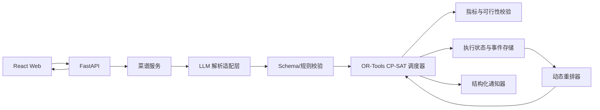

# 技术架构设计 V1

## 1. 架构目标

系统必须做到：大模型输出不可直接成为最终排程；所有排程必须经过 Schema 校验、业务规则校验和确定性约束求解。核心算法在无大模型、无前端的情况下也应可独立测试。



## 2. 推荐技术栈

| 层级 | 技术 | 选择理由 |
|---|---|---|
| 后端 | Python 3.12、FastAPI、Pydantic v2 | 与 OR-Tools 生态匹配，Schema 和 OpenAPI 生成方便 |
| 调度 | Google OR-Tools CP-SAT | 支持区间变量、资源互斥、可选任务和多目标约束 |
| 前端 | React 18、TypeScript、Vite | 与当前可运行控制台一致，类型明确，便于双人并行开发 |
| 可视化 | 当前为 React/CSS 自研资源轨道视图 | 无额外图表运行时依赖，先满足 M1 甘特图与状态展示 |
| 存储 | 开发期 SQLite；接口保持可替换 | 两人团队运维成本低，满足演示与状态持久化 |
| 测试 | pytest、Hypothesis、Vitest、Playwright | 覆盖约束、属性测试、组件和关键端到端流程 |
| 质量 | Ruff、mypy、ESLint、Prettier | 自动化格式、静态检查和类型检查 |
| 部署 | Docker Compose | 统一评测和本地环境 |

上表是当前仓库已落地或已冻结的基线；新增依赖或替换技术栈必须通过 ADR/PR 评审，不改变模块接口和验收标准。

## 3. 分层与模块边界

### 3.1 `domain` 领域模型

职责：定义菜谱、任务、设备、排程、事件和通知的唯一数据模型。

禁止：依赖 FastAPI、数据库、LLM SDK 或前端结构。

当前实现：领域对象由 V1 JSON Schema、fixture 和各模块的类型/校验函数共同承载；尚未建立独立 `backend/app/domain/` 包。新增领域模型时必须先更新 `contracts/v1/`，再在 `backend/app/` 中按模块落地，禁止在文档中把规划目录写成已存在目录。

### 3.2 `parser` 菜谱解析

职责：自然语言步骤原子化，提取设备类型、模式、温度、时长、依赖和人工介入；输出带置信度和缺失状态的结构化结果。

处理链路：

```text
菜谱原文 → Prompt/结构化输出 → Pydantic 校验 → 规则归一化 → 解析报告
```

关键约束：

- 不输出具体设备实例；
- 不执行模型生成的代码或命令；
- 温度统一为摄氏度、时长统一为秒；
- 无法确定的信息显式标为 `missing/ambiguous`，禁止静默猜测；
- 解析结果可缓存，模型供应商通过 Adapter 替换。

### 3.3 `validation` 规则校验

职责：在调度前阻止非法数据，调度后验证结果。

校验项：

- Schema、枚举和单位；
- 悬空依赖、重复 ID、循环依赖；
- 设备能力和温度范围；
- 任务时长及人工时长合法性；
- 排程设备冲突、人工冲突、依赖违反；
- 已完成任务在重排前后保持不变。

### 3.4 `scheduler` 初始调度

职责：把结构化任务和设备配置转换为可行排程。

核心建模：

- 每个任务使用 CP-SAT interval variable；
- 同类多实例设备使用 cumulative 或 optional interval 分配；
- 灶眼按独立资源建模；
- 蒸箱/烤箱共享时必须满足模式、温度和容量兼容；
- 持续人工任务占用单人人工资源；
- 前置任务通过 precedence constraint 约束；
- 不可中断任务使用连续区间。

求解采用分层目标，禁止用软目标换取硬约束违反：

1. 获得满足全部硬约束的可行解；
2. 最小化菜品完成时间差；
3. 最小化总 makespan；
4. 最小化最长连续人工操作；
5. 动态场景中最小化原计划偏移。

输出必须包括：求解状态、目标值、best bound、gap、求解耗时和可行性校验结果。

### 3.5 `execution` 执行状态与事件

职责：维护 PENDING、LOCKED、RUNNING、DELAYED、COMPLETED、EXCEPTION、CANCELLED 状态；保证事件可追溯和幂等。

每个事件包含：`event_id`、`schedule_id`、`event_type`、`task_id`、事件发生时间、实际数据和幂等键。

### 3.6 动态重排（规划中的 API 能力）

当前仓库已有 `execution` 状态迁移与排程差异基础函数，但尚未提供独立 `replanner` 包或完整动态重排 API。后续实现必须基于当前执行快照生成未来计划，不重写历史。

规则：

- COMPLETED 任务完全锁定；
- RUNNING 且不可中断任务锁定；
- 已通知且即将执行任务增加偏移惩罚；
- 新菜品经过解析和校验后才能进入剩余任务集合；
- 设备异常先禁用资源，再求解；
- 无解时返回冲突核心或可解释原因，不返回非法排程。

差异输出包括：保持、移动、资源变更、新增、取消、锁定任务及变更原因。

### 3.7 `notification` 通知

通知先由规则生成结构化事实，再选择性由大模型润色。模型不得改变触发时间、设备、温度、时长和动作。

### 3.8 `api` 接口层

职责：鉴权边界（如需要）、请求校验、服务编排、错误映射和 OpenAPI；不得在路由函数中实现调度算法。

### 3.9 `web` 前端

页面：菜品选择、厨房配置、解析结果、排程结果、实时执行、重排差异。

前端仅消费 API 返回的排程和指标，不在浏览器中自行计算正式排程。

## 4. 仓库目标结构

```text
backend/
├── app/
│   ├── parser/          # 菜谱结构化解析适配器
│   ├── validation/      # Schema、业务规则和结果校验
│   ├── scheduler/       # OR-Tools CP-SAT 调度
│   ├── execution/       # 状态机、事件和重排
│   ├── metrics/         # 多目标指标
│   ├── api.py           # FastAPI 应用工厂
│   └── main.py          # ASGI 入口
├── tests/
├── requirements.txt
└── requirements-parser.txt
frontend/
├── src/
│   ├── api/
│   ├── components/
│   ├── mock/
│   └── types/
├── public/demo/
└── package.json
contracts/v1/             # 版本化 Schema、样例与业务规则
fixtures/v1/              # 调度与验收 fixture
data/annotations/         # 标注模板、gold、review 和 reports
docs/                     # 产品、项目、技术和赛题文档
```

## 5. 横向质量要求

- 所有跨层输入输出使用显式类型和版本化 Schema；
- API 返回 `request_id` 和分阶段耗时；
- 日志不得包含 API Key 或完整敏感 Prompt；
- 相同输入、配置和随机种子下，核心排程结果应稳定；
- 每个 P0 模块必须有正常、边界、无解和超时测试；
- CI 运行契约校验、后端全量测试、前端类型检查/构建和敏感信息检查。
