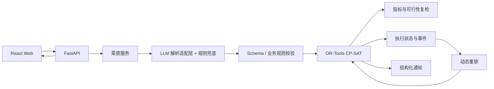

# 智能烹饪调度 Agent 技术方案（汇总）

> 赛题编号 ZX-2026-0302 · 宁波方太厨具有限公司。
> 本文档是全部技术文档的**单一汇总入口**，聚合仓库中散落的 8 份技术文档，并补上
> 「排程合理性」论证。面向评测专家与组委会评审，正文只保留结论，细节链接到对应文档。

## 1. 题目理解与系统定位

赛题把「理解层」与「规划层」拆成两个核心挑战：从自然语言菜谱提取结构化信息，再在
多资源约束下做调度优化。本系统的定位是**确定性可解释的调度内核 + 大模型理解前端**：

- 大模型只做「自然语言 → 结构化任务」，其输出**永远不直接成为排程**；
- 排程由 OR-Tools CP-SAT 确定性求解，任何输入经过 Schema、业务规则、结果校验三道关卡；
- 无大模型、无前端时，核心算法仍可独立测试（NFR-104 同输入同输出）。

详见 [技术架构设计](TECHNICAL_ARCHITECTURE.md)。

## 2. 总体架构



后端 FastAPI + OR-Tools CP-SAT + jsonschema；前端 React + TypeScript（Vite）。契约版本化于
`contracts/v1/schemas/`，全部 `additionalProperties: false`，是理解层与规划层的唯一接口。

## 3. 理解层：菜谱结构化解析（Level 1）

**策略**：LLM 结构化抽取 + 确定性规则兜底（Hybrid）。

- `DeterministicParserAdapter`（正则）是**确定性基线**，可离线跑通 100 道菜谱批量管线；
- `LLMParserAdapter` 实现 `ParserAdapter`，用 OpenAI 兼容接口调用大模型做真实自然语言理解；
- 模型字段**逐字段覆盖**基线，只接受合法值，非法值回退规则基线，保证输出**恒**通过
  `task.schema.json`；
- 每个字段带 `field_status`（`provided / inferred / defaulted / missing`）显式暴露不确定性的来源。

四维准确率（设备 / 时间 / 依赖 / 人工介入）通过 `data/annotations/` 的 gold/predictions/reports
离线评测。详见 [Prompt 策略](PROMPT_STRATEGY.md) 与 [数据与 API 契约](DATA_AND_API_CONTRACT.md)。

## 4. 规划层：多菜并行调度（Level 2）

CP-SAT 建模（`app/scheduler/cp_sat.py`）：

- 每个任务一个 `IntervalVar`，设备任务用 `NewOptionalIntervalVar` + `AddExactlyOne` 分配到
  一台兼容设备；
- 设备容量互斥用 `AddCumulative`（同一灶眼不能同时炒两道菜）；
- **蒸箱/烤箱模式·温度互斥**：同一蒸烤箱上「不同模式或不同温度」的任务禁止时间重叠，即使
  设备还有富余容量——与赛题「蒸箱不能同时进行不同温度的蒸制」逐字对应；
- 人工操作用 `AddCumulative` 占单人人工资源；
- 前置依赖用 precedence 约束；不可中断任务用连续区间。

## 5. 多目标优化（Level 3）

字典序分层求解，硬约束永远优先、不用软目标换取硬约束违反：

```text
(hard_constraint_violations, finish_spread_sec, makespan_sec, max_continuous_manual_sec)
```

分阶段求解：先最小化同出锅时间差 → 固定该值再最小化总 makespan → 再最小化最长连续人工操作。
`max_continuous_manual_sec` 按赛题口径（相邻人工段间隔 ≤ 30s 合并）精确建模，报告的指标与
优化的目标量一致。详见 [多目标指标与分层优化](MULTI_OBJECTIVE_OPTIMIZATION.md)。

上报指标（`schedule-response.metrics`）：

- `finish_spread_sec`、`makespan_sec`、`max_continuous_manual_sec`；
- `serial_baseline_sec` 与 `makespan_compression_ratio`（**总烹饪时间压缩率** = makespan / 串行基线）；
- `device_conflicts`、`dependency_violations`（由独立结果校验器复检后写入，非硬编码 0）。

## 6. 动态重排与通知（Level 4）

- 事件类型：`TASK_COMPLETED / TASK_DELAYED / DISH_ADDED / DEVICE_UNAVAILABLE`；
- 锁定语义：`COMPLETED`、`RUNNING`、显式 `LOCKED` 任务**不移动**，最小扰动原则（不推翻已完成步骤）；
- 加菜（DISH_ADDED）新任务先经解析与校验再进入重排；设备异常先禁用资源再求解；
- 差异输出 `ADDED / REMOVED / MOVED / RESOURCE_CHANGED / LOCKED / UNCHANGED` + 扰动指标；
- 无解返回 409 + 冲突原因，超时返回 504，**不返回非法排程**。

通知是**结构化事实**（触发时间、设备、动作、参数），文案按「相对时间 + 可操作」打磨：

- 提前节点：`3 分钟后需要：翻炒红烧排骨`；
- 就绪节点：`现在可以开始：切西兰花`；
- 变更通知：`翻炒红烧排骨：推迟 5 分钟，请按新时间执行。`

详见 [动态重排 API](DYNAMIC_REPLAN_API.md)、[执行状态机](EXECUTION_STATE_MACHINE.md)。

## 7. 性能效率（Level 5）

- 初始排程目标：< 5s（优秀）/ < 10s（合格）；实测见 [性能基准](PERFORMANCE_BENCHMARK.md)；
- 动态重排目标：< 3s（优秀）/ < 8s（合格）；`docs/evaluation/` 保存性能基线 JSON；
- 求解器设 `max_time_in_seconds` 上界，超时即返回 `UNKNOWN`，绝不挂死。

## 8. 排程合理性说明（专家评审）

> 说明「为什么这个排程合理」，对应专家评审 35% 中的「排程合理性」。

**为什么分层目标次序合理。** 赛题三级目标依次是「同出锅（<5 分钟优秀）→ 总时间最短 →
连续人工操作短」。字典序把同出锅放在最前，意味着当「一起上桌」与「更短总时长」冲突时优先
保证同出锅，再在剩余优化空间中压缩总时长。这与家庭「多菜一起开饭」的真实诉求一致；若反过来
先压缩总时长，可能出现一道菜早 20 分钟出锅、另一道还在做，反而不符合多菜场景。

**为什么「模式·温度互斥」必须建模。** 蒸箱不能同时进行不同温度的蒸制，是**物理约束**而非
偏好。容量互斥只保证「同一设备同一时刻占用 ≤ 容量」，当设备容量 ≥ 2 时会放行「不同温度同蒸」，
这正是规则里明确禁止的。因此系统把模式/温度互斥作为硬约束，与容量互斥并列。

**为什么最小扰动。** 重排只锁定已执行/执行中任务，其余任务尽量保持原计划（差异输出 + 扰动
指标）。烹饪中途推翻已完成的步骤没有意义，反而造成用户困惑，因此「不推翻已完成步骤」是硬性
要求，而不是优化项。

**为什么可解释。** 每个排程同时输出：求解状态 / 目标值 / best bound / gap / 分阶段耗时 /
四维冲突复检结果 / 每个任务的时间窗与资源分配。甘特图由排程 JSON 直接渲染，前端不自行计算，
因此「图上看到的」与「系统算出的」永远一致。

## 9. 交付物索引

| 交付物 | 位置 |
|---|---|
| 系统源代码 + 部署 | `backend/`、`frontend/`、`docker-compose.yml` |
| API 接口 | [API_ENDPOINTS.md](API_ENDPOINTS.md) + OpenAPI（FastAPI 自动生成） |
| 技术方案（本文档） | `TECHNICAL_PROPOSAL.md` |
| 架构说明 | [TECHNICAL_ARCHITECTURE.md](TECHNICAL_ARCHITECTURE.md) |
| 调度算法设计 | [MULTI_OBJECTIVE_OPTIMIZATION.md](MULTI_OBJECTIVE_OPTIMIZATION.md) |
| Prompt 策略 | [PROMPT_STRATEGY.md](PROMPT_STRATEGY.md) |
| 通知生成机制 | `app/notifications.py` + `app/execution/diff.py` |
| 校验与结果复检 | [VALIDATION_ENGINE.md](VALIDATION_ENGINE.md) |
| 性能基线 | [PERFORMANCE_BENCHMARK.md](PERFORMANCE_BENCHMARK.md)、`docs/evaluation/` |
